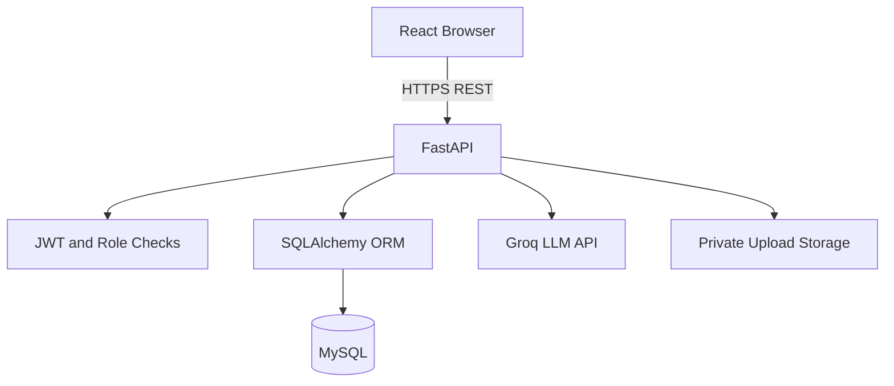

# 02 – System Architecture

## Components
- React/Vite SPA: public pages and role-specific dashboards.
- FastAPI: REST endpoints, validation, authorization and workflow.
- SQLAlchemy: persistence and ORM mapping.
- MySQL: relational data store.
- Groq API: LLM-powered complaint triage.
- Local uploads directory: development attachment storage.

## Request flow
Browser → Axios → FastAPI router/endpoint → service/business logic → SQLAlchemy → MySQL.
AI analysis calls Groq from the backend only. API keys are never sent to the browser.

## Security boundaries
JWT bearer token, Argon2 password hashing, role checks, citizen ownership checks, officer department checks, upload size/extension restrictions and explicit CORS origins.

## Deployment topology
Deploy React static build separately from FastAPI. Use managed MySQL and persistent private file storage. Configure VITE_API_URL, DATABASE_URL, SECRET_KEY, GROQ_API_KEY, GROQ_MODEL and FRONTEND_ORIGINS.

## Mermaid architecture

