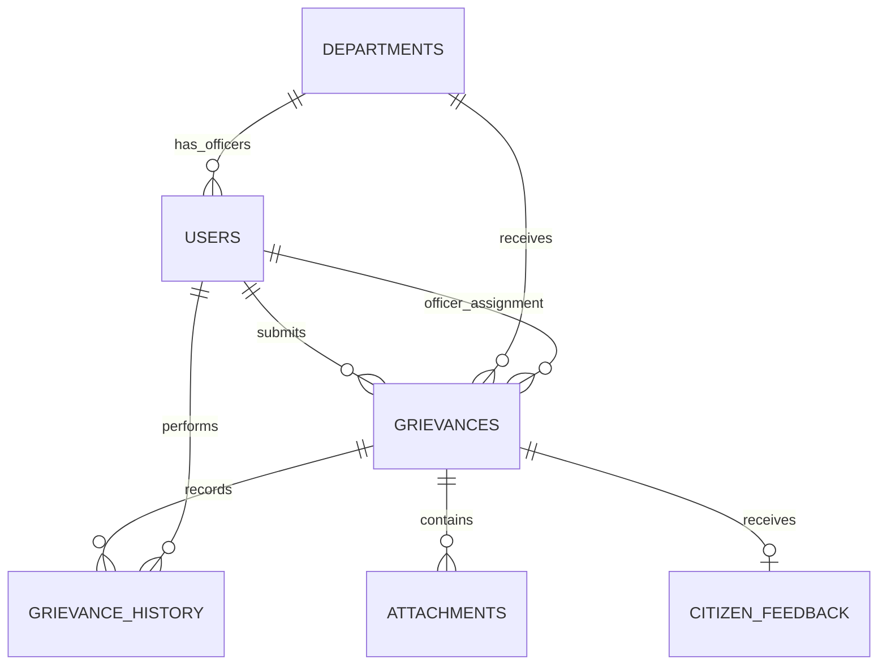

# 03 – Database Design

Tables are created by SQLAlchemy `Base.metadata.create_all()` during API startup.

| Table | Purpose |
|---|---|
| users | Citizens, CMO admins and department officers |
| departments | Sample government departments |
| grievances | Main grievance record, status, priority, assignment and AI output |
| grievance_history | Immutable-style status transition audit records |
| attachments | Stored attachment metadata |
| citizen_feedback | One feedback record per grievance |
| contact_enquiries | Contact form submissions |

## Relationships
- A user (citizen) can create many grievances.
- A department can receive many grievances and have many officers.
- A grievance has many history rows and attachments.
- A grievance can have one citizen feedback record.
- A grievance may be assigned to one department and one officer.

## ER diagram

Use `database/schema.sql` to create the database before starting the backend. SQLAlchemy creates the tables.
